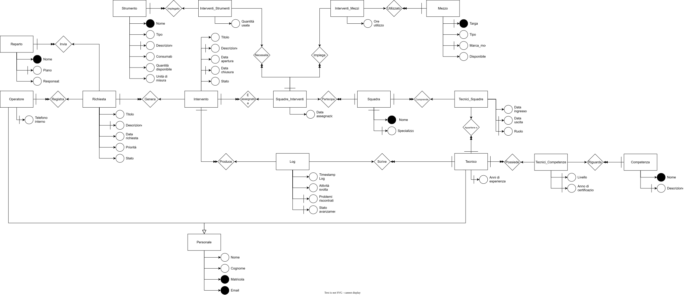

# Database Manutenzione Aziendale

Progetto di modellazione e gestione dei dati per la manutenzione aziendale, con uno schema relazionale MySQL e una successiva estensione MongoDB/Node.js dedicata ai registri delle attività tecniche.
La componente NoSQL reinterpreta manualmente una parte del dominio: i due database sono indipendenti e non vengono sincronizzati dall'applicazione.

MySQL · SQL · MongoDB · Node.js · Express · Mongoose · dotenv · nodemon

## Panoramica

Il modello segue il percorso di una segnalazione proveniente da un reparto: registrazione da parte di un operatore, apertura di eventuali interventi, assegnazione delle squadre e delle risorse, registrazione delle attività dei tecnici.

Personale, competenze, appartenenze alle squadre, mezzi e strumenti consentono di interrogare sia l'organizzazione sia il lavoro svolto. L'estensione NoSQL riprende soltanto i log e li rende gestibili attraverso un'API REST locale. Il progetto permette di confrontare la rappresentazione relazionale con quella documentale sullo stesso insieme di informazioni.

## Ambito e requisiti del progetto

Il progetto nasce dalla necessità di gestire le richieste di manutenzione all'interno di un'azienda. Un operatore dell'ufficio tecnico riceve le segnalazioni dei reparti e le registra con le informazioni necessarie a identificarle, classificarle e seguirne la gestione.

Una richiesta può generare un intervento che coinvolge una o più squadre, ciascuna composta da uno o più tecnici con competenze specifiche: manutenzione elettrica, meccanica, idraulica, informatica o gestione impianti. Durante l'intervento le squadre possono ricevere mezzi aziendali, strumenti e materiali operativi, come utensili, ricambi, dispositivi di sicurezza e apparecchiature diagnostiche.

Il dominio prevede che ciascun tecnico possa aggiornare un registro delle attività, annotando lavoro svolto, problemi riscontrati, materiali utilizzati e avanzamento. Queste informazioni servono a monitorare le manutenzioni, mantenere la tracciabilità delle operazioni e supportare l'analisi del lavoro delle squadre. I materiali sono rappresentati nelle assegnazioni degli strumenti e possono essere descritti nel testo del log; non esiste un campo strutturato dedicato ai materiali nel log.

Gli artefatti richiesti sono:

- un diagramma ER del sistema;
- il codice SQL per creare le tabelle;
- almeno 2–3 inserimenti per ciascuna tabella principale;
- le 14 interrogazioni riportate di seguito;
- un'estensione MongoDB di una tabella del progetto, gestita tramite Node.js con operazioni CRUD.

| Query | Informazione richiesta |
| --- | --- |
| Q1 | Richieste di manutenzione con l'operatore che le ha registrate. |
| Q2 | Interventi aperti in una determinata data. |
| Q3 | Tecnici con una specifica competenza, ad esempio manutenzione elettrica. |
| Q4 | Mezzi aziendali utilizzati in un determinato intervento. |
| Q5 | Interventi che hanno coinvolto più di una squadra. |
| Q6 | Numero di log per ogni intervento. |
| Q7 | Numero totale di interventi gestiti da ciascuna squadra. |
| Q8 | Tecnici che hanno partecipato al maggior numero di interventi. |
| Q9 | Numero di richieste ricevute per giorno e quante hanno generato almeno un intervento. |
| Q10 | Interventi generati da una specifica richiesta. |
| Q11 | Squadre assegnate a un determinato intervento. |
| Q12 | Tecnici presenti in una specifica squadra. |
| Q13 | Tecnici che hanno partecipato a un determinato intervento. |
| Q14 | Squadre, tecnici, mezzi e strumenti/materiali coinvolti in ciascun intervento. |

L'implementazione comprende 16 tabelle, dati dimostrativi per tutte le tabelle, due viste di supporto e le 14 query. Realizza il modello di persistenza e le interrogazioni, senza un'interfaccia operativa MySQL per operatori e tecnici. Il minimo di membri per squadra e di squadre per intervento previsto dal dominio non è imposto dallo schema.

L'estensione seleziona la tabella `Log` e ne reinterpreta i dati in documenti MongoDB gestiti da un'API Node.js; non riproduce l'intero schema MySQL. Le assunzioni e i vincoli non coperti sono descritti nelle [note progettuali](docs/note-progettuali.md).

## Struttura della repository

```text
sql/
  schema.sql
  dati.sql
  query.sql
mongodb/
  app.js
  .env.example
  models/Log.js
  package.json
  package-lock.json
diagrams/
  DiagrammaER_ManutenzioneAzienda__ArlonCava.drawio
  DiagrammaER_ManutenzioneAzienda__ArlonCava.svg
docs/
  note-progettuali.md
README.md
```

`sql/` contiene struttura, dati e interrogazioni separati nei file `schema.sql`, `dati.sql` e `query.sql`. `mongodb/` contiene l'API e il modello Mongoose. `diagrams/` conserva il sorgente modificabile e l'esportazione ER. `docs/` approfondisce le scelte progettuali.

## Componente relazionale

- `Personale` raccoglie i dati comuni; `Operatore` e `Tecnico` condividono la chiave con la tabella padre.
- Ogni `Richiesta` identifica il reparto e l'operatore che la registra. Può generare zero o più `Intervento`.
- `Tecnici_Competenze`, `Tecnici_Squadre` e `Squadre_Interventi` modellano le relazioni molti a molti. L'appartenenza alle squadre conserva date di ingresso e uscita.
- `Interventi_Mezzi` e `Interventi_Strumenti` assegnano risorse a una squadra già coinvolta nell'intervento, tramite foreign key composta.
- `Log` collega ogni attività al tecnico autore e all'intervento.

Chiavi primarie, foreign key, vincoli `UNIQUE`, `NOT NULL` e `CHECK` controllano identificativi, valori ammessi e alcune condizioni temporali. Le cancellazioni combinano `CASCADE` e restrizioni: in particolare, le assegnazioni di risorse possono impedire di eliminare un intervento e i log impediscono di eliminare il tecnico autore.

Il dataset include 9 dipendenti, 6 richieste, 4 interventi, 3 squadre e 9 log. Contiene richieste senza intervento, una collaborazione tra squadre e un trasferimento storico di un tecnico. Le date di esempio sono comprese nel marzo 2025 e non attestano il periodo di realizzazione del progetto.

## Modello dati



[Sorgente draw.io](diagrams/DiagrammaER_ManutenzioneAzienda__ArlonCava.drawio): la prima pagina contiene il diagramma, la seconda le premesse progettuali. Il diagramma è concettuale: identificativi, chiavi e dettagli dei vincoli devono essere letti nello [schema SQL](sql/schema.sql).

Le relazioni centrali sono richiesta–intervento, squadra–intervento e tecnico–squadra. L'assegnazione delle risorse dipende dalla coppia squadra/intervento. La partecipazione di un tecnico viene ricostruita dalla sua appartenenza alla squadra alla data di assegnazione, secondo l'assunzione esplicitata nel diagramma.

## Query significative

Le interrogazioni complete sono in [query.sql](sql/query.sql).

| Query | Obiettivo | Elaborazione e tecnica |
| --- | --- | --- |
| Q3 | Individuare i tecnici con una competenza | Join tra vista dei tecnici, associazioni e competenze; filtro per nome. |
| Q5 | Trovare interventi con più squadre | Raggruppamento per intervento e selezione con `HAVING`. |
| Q6 | Contare i log, includendo interventi senza log | `LEFT JOIN` e `COUNT` sulla chiave del log. |
| Q8 | Ordinare i tecnici per interventi assegnati | Filtro temporale sull'appartenenza e conteggio degli interventi distinti. |
| Q9 | Contare richieste giornaliere e richieste con interventi | `DATE`, `LEFT JOIN` e conteggi distinti per evitare sovraconteggi. |
| Q14 | Mostrare squadre, tecnici e risorse di ciascun intervento | Join sulla coppia squadra/intervento; dettaglio delle combinazioni, senza attribuire una risorsa a squadre diverse. |

Q8 restituisce la classifica completa, inclusi eventuali pari merito. Q14 può produrre più righe per tecnico quando la squadra impiega più risorse: il numero delle righe non rappresenta il numero di partecipanti o risorse.

## Estensione NoSQL

Il modello [Log.js](mongodb/models/Log.js) conserva `intervento` e `tecnico` come identificativi numerici corrispondenti concettualmente a `intervento_RIF` e `tecnico_RIF` in SQL. Ogni documento riceve un proprio `_id` MongoDB; non conserva il `log_ID` SQL.

Il documento include `timestamp_log`, `attivita_svolta`, `problemi_riscontrati` e `stato_avanzamento`. La data ha come valore predefinito l'istante corrente; i due campi testuali facoltativi hanno valore predefinito `null`.

Non sono presenti collezioni di tecnici o interventi, riferimenti Mongoose con `ref`, `populate`, importatori SQL o controlli dell'esistenza degli identificativi nei database. Gli ID vengono forniti manualmente. Il modello usa un minimo numerico di 1, ma non impone che gli ID siano interi.

## Funzionalità CRUD

L'applicazione restituisce JSON e non contiene template, pagine HTML o dashboard.

| Metodo | Percorso | Operazione |
| --- | --- | --- |
| `GET` | `/registri-log` | Elenco di tutti i log. |
| `GET` | `/registri-log/:id` | Lettura di un documento tramite `_id`. |
| `POST` | `/registri-log` | Creazione di un log. |
| `PUT` | `/registri-log/:id` | Aggiornamento dei campi forniti, con validatori Mongoose. |
| `DELETE` | `/registri-log/:id` | Eliminazione di un documento. |

Non sono implementati filtri, paginazione o autenticazione. Il `PUT` aggiorna i campi ricevuti tramite `findByIdAndUpdate`: non sostituisce integralmente il documento.

## Avvio del progetto

### MySQL

Usare MySQL 8.0.16 o successivo per l'applicazione dei `CHECK`. Gli script utilizzano stringhe tra virgolette doppie: la sessione deve avere `ANSI_QUOTES` disabilitato. Servono privilegi per creare database, tabelle e viste.

**`schema.sql` elimina e ricrea il database `Manutenzione_Azienda`, cancellandone gli eventuali dati. Eseguirlo soltanto in un ambiente di prova dedicato.**

Aprire il client nella root del progetto:

```sh
mysql -u <utente> -p
```

Quindi eseguire, nello stesso client:

```sql
SOURCE sql/schema.sql;
SOURCE sql/dati.sql;
SOURCE sql/query.sql;
```

In MySQL Workbench è possibile aprire ed eseguire i tre file nello stesso ordine. Ogni script seleziona il database; le viste vengono create da `schema.sql`. Per cambiare gli esempi di interrogazione, modificare date, identificativi o competenza nei filtri di `query.sql`.

### MongoDB / Node.js

Prerequisiti: MongoDB disponibile localmente e Node.js compatibile con il lockfile. Mongoose 9.6.2 e il driver MongoDB 7.2.0 registrati nel lockfile richiedono Node.js `>=20.19.0`.

Installare le dipendenze:

```sh
cd mongodb
npm ci
```

Su PowerShell, se `npm.ps1` viene bloccato dalla Execution Policy, utilizzare `npm.cmd`.

Per personalizzare la configurazione, copiare [`.env.example`](mongodb/.env.example) in `.env` nella cartella `mongodb/`. Il file di esempio contiene:

```dotenv
PORTA=4000
INDIRIZZO=localhost
DB=mongodb://localhost:27017/Manutenzione_Azienda
```

Sono gli stessi valori predefiniti del codice; l'esempio locale non contiene credenziali. Non pubblicare un `.env` contenente configurazioni private.

Avviare il servizio MongoDB installato oppure, in un terminale separato, avviare un'istanza locale con una directory dati dedicata già creata:

```sh
mongod --dbpath <directory-dati> --bind_ip 127.0.0.1 --port 27017
```

Da `mongodb/` avviare l'applicazione:

```sh
npm start
```

Lo script usa nodemon; è possibile avviare direttamente anche `node app.js`. Visitare `http://localhost:4000/registri-log` per ottenere l'elenco JSON. Non è previsto un dataset MongoDB iniziale.

Per creare un documento, inviare un `POST` con `Content-Type: application/json` a `/registri-log` usando questo corpo:

```json
{
  "intervento": 1,
  "tecnico": 4,
  "attivita_svolta": "Ispezione del quadro elettrico",
  "problemi_riscontrati": null,
  "stato_avanzamento": "25%"
}
```

Usare l'`_id` restituito per lettura, modifica e cancellazione. Non è necessario avviare MySQL per usare l'API: gli identificativi numerici non vengono verificati dal server.

## Aspetti tecnici principali

- Modellazione di richieste, interventi e risorse con relazioni uno a molti e molti a molti.
- Integrità referenziale delle assegnazioni tramite una foreign key composta.
- Separazione dei dati comuni del personale dai ruoli di operatore e tecnico.
- Join, aggregazioni e filtri temporali nelle interrogazioni SQL.
- Reinterpretazione dei log come documenti con validazione Mongoose.
- API CRUD Express con risposte JSON e configurazione tramite ambiente.

## Scelte progettuali

I dati anagrafici sono centralizzati in `Personale` per evitare duplicazioni tra ruoli. Le competenze sono entità autonome per essere ricercabili e associabili a più tecnici.

Lo storico `Tecnici_Squadre` permette rientri nella stessa squadra, includendo la data di ingresso nella chiave primaria. L'unità di assegnazione all'intervento è la squadra: non esiste un elenco separato dei tecnici effettivamente presenti.

Le risorse sono collegate alla partecipazione della squadra all'intervento. L'estensione documentale mantiene invece i soli log e riferimenti numerici, senza duplicare le anagrafiche del modello relazionale.

## Limitazioni

- Nessuna sincronizzazione automatica, importazione o verifica dei riferimenti tra SQL e MongoDB.
- Nessuna interfaccia grafica, autenticazione o suite di test automatici.
- Connessione MongoDB aperta e chiusa in ogni route, con disconnessioni non attese e gestione incompleta in caso di errore: richieste concorrenti possono interferire.
- Risposte di errore poco differenziate: alcuni errori di validazione producono `500`, altri errori vengono riportati come `404`.
- In SQL non sono garantiti minimo di membri per squadra, minimo di squadre per intervento, assenza di sovrapposizioni nelle appartenenze o coerenza tra autore del log e squadre assegnate. Disponibilità e quantità delle risorse non vengono aggiornate automaticamente.


## Possibili sviluppi

- Gestire una connessione MongoDB persistente e la chiusura ordinata dell'applicazione.
- Distinguere errori di input, documento assente ed errore del database.
- Aggiungere prove delle query su dati limite e test delle route CRUD.
- Rafforzare la validazione degli identificativi numerici e degli intervalli di appartenenza.

## Competenze consolidate

- Progettazione di entità, relazioni e tabelle associative.
- Definizione di chiavi, vincoli e politiche di cancellazione.
- Interrogazioni SQL con viste, join, raggruppamenti e filtri temporali.
- Modellazione di documenti MongoDB con Mongoose.
- Implementazione di operazioni CRUD in Node.js ed Express.
- Confronto concreto tra integrità relazionale e riferimenti applicativi in un modello documentale.

## Contesto

Progetto realizzato nell'ambito ITS Academy, come progetto finale del corso "Database relazionali e NoSQL". 

## Autore

Arlon Cava
